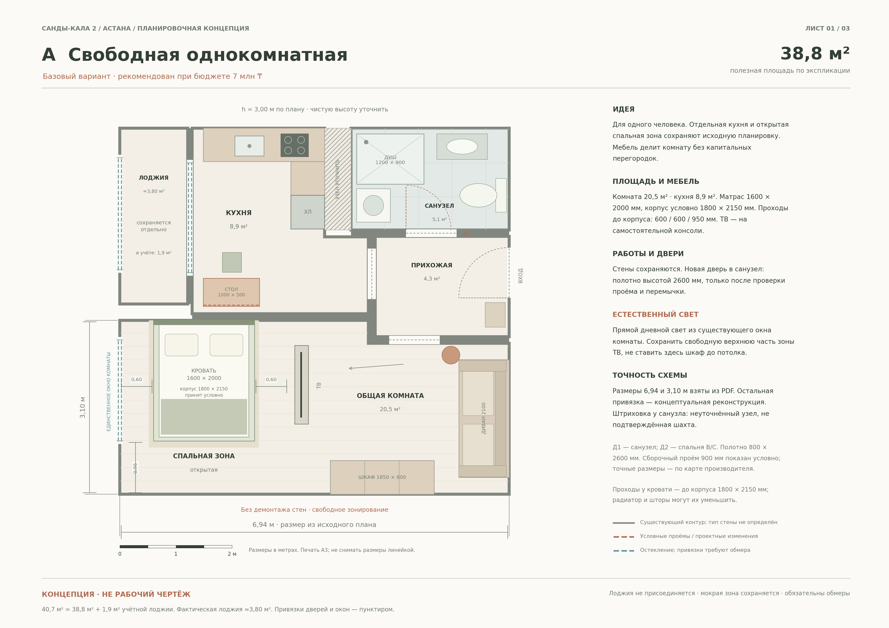
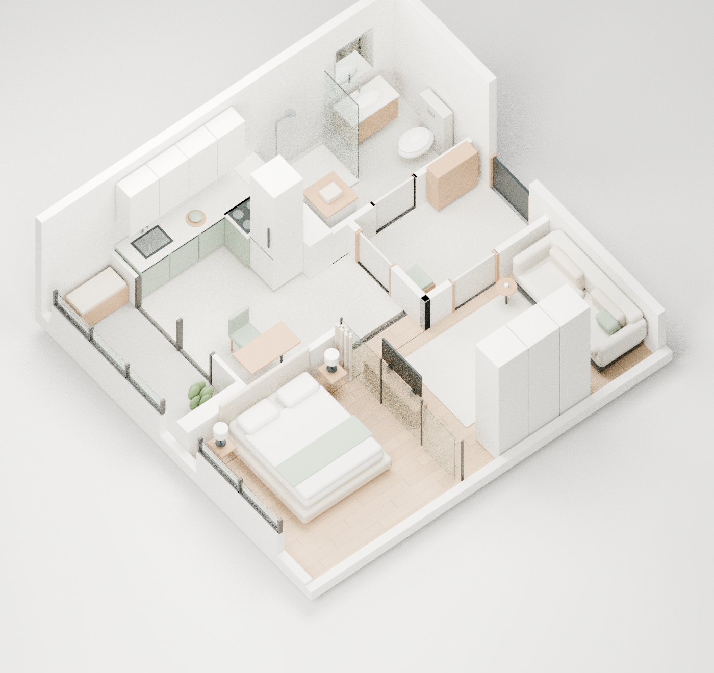

# Санды-кала 2 — дизайн-концепция квартиры

Астана · один жилец · 38,8 м² полезной площади / 40,7 м² по экспликации · бюджет 7 млн ₸ без крупной техники · межкомнатные полотна высотой 2600 мм.

## Скачать

| Файл | Содержание | Размер |
| --- | --- | --- |
| **[Полный проект — ZIP](design/Project.zip)** | Альбом, планы, расчёты, изображения, три модели Blender, автономное сравнение вариантов и исходники | ≈26,8 МБ |
| [Альбом проекта — PDF](design/Design.pdf) | 16 страниц: исходные данные, варианты, 3D, материалы, двери, объёмы и бюджет | ≈3,4 МБ |
| [Планы A/B/C — PDF](design/Plans.pdf) | Три векторных листа A3 с мебелью и размерами | ≈60 КБ |
| [Бюджет и расчёты — Excel](design/Budget.xlsx) | Пять листов с формулами; редактируемые значения выделены синим | ≈23 КБ |

Чтобы скачать файл, откройте его ссылку и нажмите **Download raw file** — кнопку со стрелкой вниз в панели файла GitHub. Для всего репозитория можно выбрать **Code → Download ZIP**.

## Варианты

- **A — без перепланировки.** Отдельная кухня, единая жилая комната с открытой спальной зоной. Исходная рекомендация для одного жильца: больше открытости и меньше дополнительных работ.
- **B — закрытая спальня.** Спальня около 9,3 м² и кухня-гостиная около 19,8 м². У гостиной нет собственного окна.
- **C — стекло и штора.** Та же геометрия спальни с прозрачным разделением; при открытой шторе лучше передача света. Стоимость системы требует отдельного предложения.

| Вариант | План | 3D-вид |
| --- | --- | --- |
| A | [Открыть](design/previews/Plan_A.png) | [Открыть](design/previews/3D_A.png) |
| B | [Открыть](design/previews/Plan_B.png) | [Открыть](design/previews/3D_B.png) |
| C | [Открыть](design/previews/Plan_C.png) | [Открыть](design/previews/3D_C.png) |

### План A

### Объёмная концепция C

### Материалы и настроение

[Сравнение атмосферных эскизов A/B/C](design/previews/Interior_concepts_A_B_C.png) · [Кухня, санузел, прихожая и спальня](design/previews/Materials_and_rooms.png)

## Статус проекта

Это **эскизная концепция**, подготовленная по предоставленному плану и визуальному анализу видео. Она не заменяет натурный обмер, согласование перепланировки и рабочие чертежи. Привязки проёмов, стыки и конструкция стен требуют проверки. Возможность увеличения проёмов под полотно 2600 мм зависит от перемычек, отметки чистого пола и выбранной дверной системы.

Лоджия сохраняется отдельной; кухня и санузел остаются в исходных зонах. Новое соединение кухни и гостиной в B/C условно до конструктивной и местной правовой проверки. Атмосферные изображения показывают материалы; размеры следует брать из схем с учётом отмеченных допущений.

Бюджет — распределение лимитов, **не подтверждённая рыночная смета**: 6,3 млн ₸ на работы и покупки плюс 700 тыс. ₸ резерва. Крупная техника исключена.

Три исходные модели `.blend` находятся в полном архиве. В них сохранены камеры и полная архитектура для дальнейшей детализации. **Видеоролик ещё не создавался.**

Версия концепции: 10.10.2026.
