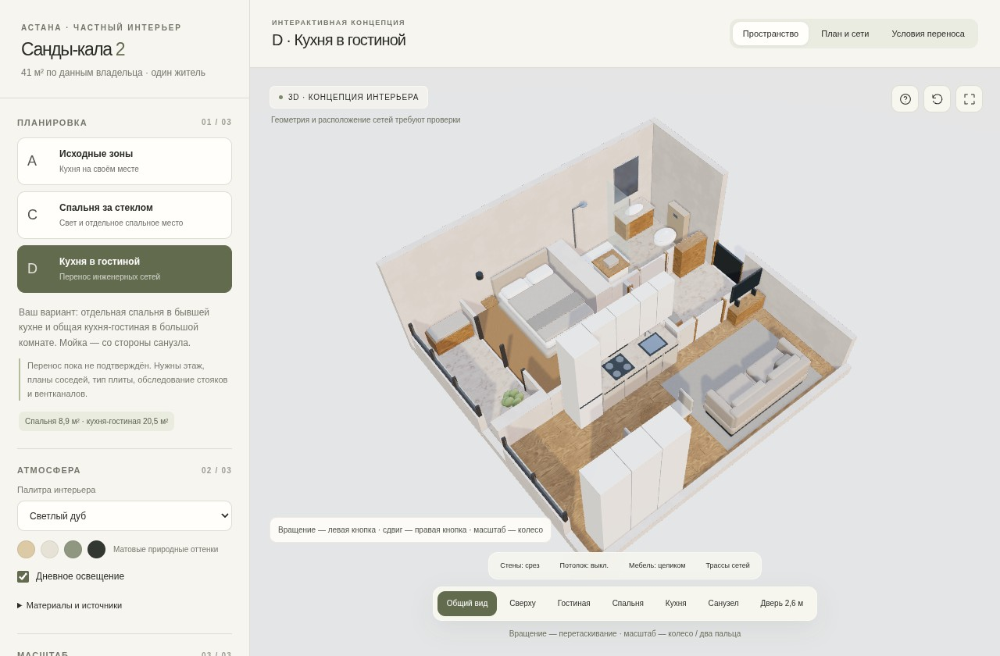

# Санды-кала 2 — интерактивный интерьер и проверка переноса кухни

**[Скачать интерактивный 3D — Apartment_3D.html](Apartment_3D.html)**

1. Откройте ссылку и нажмите **Download raw file** — стрелку вниз на странице файла GitHub.
2. Сохраните файл с расширением `.html` на компьютер.
3. Откройте его в актуальном Chrome, Edge, Firefox или Safari с поддержкой WebGL. Все модели, текстуры и код находятся внутри файла; интернет для просмотра не нужен. На самой странице GitHub HTML показывается как файл, а не как работающий сайт.

Мышь: левая кнопка — вращение, правая — сдвиг, колесо — масштаб. На сенсорном экране: один палец — вращение, два — масштаб и сдвиг. Можно выбрать готовые ракурсы комнат, включить полные стены и потолки, убрать верх высокой мебели, показать инженерные линии, изменить палитру и освещение. Управление камерой свободное: это просмотр модели, без физической проверки столкновений при перемещении.

## Что сравнивается

| Вариант | Планировка | Статус |
| --- | --- | --- |
| **A** | Кухня на исходном месте, открытая спальная зона в жилой комнате | База для сравнения объёма работ |
| **C** | Кухня на месте, спальня у окна за стеклом и шторой | Новый проход кухня–гостиная требует проверки стены и допустимости |
| **D** | Спальня 8,9 м² в бывшей кухне; кухня-гостиная 20,5 м² в большой комнате | Перенос кухни и инженерии **пока не подтверждён** |

В D кухонный блок длиной около 2,70 м поставлен ближе к санузлу; мойка — на ближнем конце. Для одного жильца предложен матрас 140 × 200 см с односторонним доступом около 73 см по модели. Основной шкаф вынесен в большую комнату. Расстояние от края круглого стола до кухонного фронта около 71 см — компактный проход; мебель и открывание фасадов нужно проверить после обмера. ТВ смещён относительно дивана из-за исходного дверного проёма.

## Вывод по переносу

Функционально D можно рассматривать, но сейчас нельзя подтвердить, что ремонт получится выполнить и согласовать без проблем. Неизвестны этаж, назначение помещений у соседей сверху/снизу, тип плиты, точки и отметки стояков, назначение вентканалов. В модели D показана электрическая плита; при газе схема требует пересмотра. Юридическая допустимость по действующим требованиям Казахстана не установлена; нормы РФ здесь не применялись.

- **Канализация.** На эскизе возможный маршрут к санузлу — около 3,22 м, точка подключения условная. При выбранном для расчёта уклоне 3% перепад составит примерно 97 мм. Труба с наружным диаметром 50 мм и условный верхний запас 20 мм дают около **167 мм плюс неизвестная нижняя отметка трубы у врезки**. Это не готовая толщина стяжки: ещё проверяются раструбы, крепления, звукоизоляция, нагрузка и слои пола. Маршрут пересекает прихожую и зону входа в спальню; одного кухонного цоколя здесь недостаточно. Несущую плиту под трубу не штрабить по этому эскизу.
- **Вентиляция.** Подключение кухонного зонта к вытяжному каналу санузла **не предлагается**. Фиолетовая линия показывает предмет проверки — отдельный путь к штатному кухонному каналу, положение которого неизвестно. Сечение, допустимость подключения, режим вентилятора, шум и приток определяет инженер. Рециркуляционная вытяжка не заменяет воздухообмен.
- **Существующая кухня.** Сначала обследовать её нынешнее подключение: оно может позволить более короткий путь, чем подключение через санузел. По этому плану нельзя утверждать, что все трубы надо вести именно из туалета.
- **Высокая дверь.** Полотно — 2600 мм. При исходных 3000 мм, поле 180 мм и потолочном коробе 250 мм остаётся лишь 2570 мм: в такой зоне полотно не помещается даже без учёта коробки. Разнести воздуховод и высокий проём либо пересмотреть отметки. Монтажный проём определяется выбранной системой, универсальной прибавки нет.
- **Новая спальня.** Свет через отдельную остеклённую лоджию, воздухообмен и возможность использования бывшей кухни как спальни требуют проверки. Лоджия остаётся отдельной.

При лимите 7 млн ₸ без крупной техники D стоит выбирать только после проверки допустимости и отдельной сметы переноса. Стоимость дополнительных работ здесь не выдана за подтверждённую рыночную смету. A/C позволяют сравнить варианты с кухней на исходном месте.

## Что внутри HTML

- Три настоящие 3D-модели, а не вращение плоской картинки.
- Вкладка **«План и сети»**: условные трассы и калькулятор уклона, габарита трубы, чистой высоты под коробом. Уклоны 2% и 3% — сценарии расчёта, не подтверждённый норматив для квартиры.
- Вкладка **«Условия переноса»**: архитектурные, инженерные и бюджетные ограничения.
- Реальные карты материалов ambientCG **Wood048, Fabric036, Plaster001, Marble014** и HDRI **Venice Sunset**. Все CC0; источники и изменения перечислены в [MATERIAL_SOURCES.md](MATERIAL_SOURCES.md). Порода древесины, артикулы отделки и стоимость закупки по этим текстурам не устанавливаются.
- Базовая чистая высота 3D-модели **2,86 м условная**. Калькулятор проверяет другие отметки отдельно и не перестраивает геометрию. В общих видах стены и при желании высокая мебель показаны срезом.

[Подробная инженерная записка](Engineering_review.md) · [Исходники HTML и моделей](HTML_source.zip)

Геометрия основана на исходной схеме с допущениями. Точки канализации, вентиляции, положения проёмов и конструкция стен не подтверждены натурным обследованием. Это предпроектное предложение для обсуждения, не рабочий проект и не заключение о согласуемости.

Версия: 12.10.2026.
