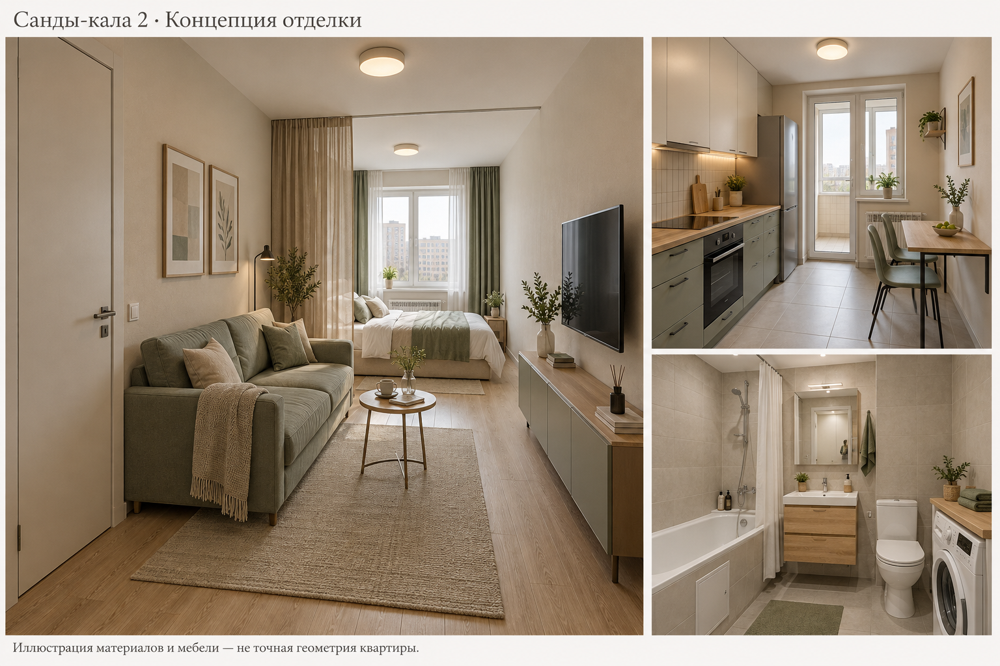

# Материалы и предварительная смета · Санды-кала 2

Астана · 13.10.2026 · один житель · кухня остаётся на исходном месте · бюджет 7 млн ₸ **без крупной техники**.

**[Смета Excel — количества, цены и формулы](Renovation_estimate.xlsx)** · **[Краткий альбом PDF](Renovation_brief.pdf)** · [Изображение интерьера](Interior_concept.png) · [Эскиз санузла с ванной](Bathroom_proposal.svg)

[Ведомость для запроса поставщикам — CSV](Shopping_list.csv). В Excel шесть листов и 58 закупочных/расчётных позиций; синие ячейки редактируются, итоги пересчитываются.

Откройте нужный файл в GitHub и нажмите **Download raw file** (стрелка вниз). Таблицу можно редактировать в Excel или LibreOffice.

## Что подтверждено, а что принято для расчёта

- В ставку бригады **50 000 ₸/м²**, по ответу владельца, включены подготовка стен под покраску, сантехнические и электротехнические работы. В расчёте это **цена работ, материалы отдельно**. Если подрядчик имел в виду также материалы, таблицу надо пересобрать, чтобы не платить дважды.
- Для договора условно взяты **41 м² × 50 000 = 2 050 000 ₸**. По исходной экспликации полезная площадь — 38,8 м², учётная — 40,7 м² с долей лоджии. Соответствующая цена работ: 1 940 000 / 2 035 000 ₸. Базу обмера для оплаты согласовать письменно; отделка лоджии в материалах этой сметы не предусмотрена.
- Кухня, ванная и стояки остаются на местах. Нет расходов на перенос кухни, расширение проёмов, присоединение лоджии, новую стеклянную перегородку или шкаф-кровать.
- Предполагается пригодная базовая стяжка; заложено финишное выравнивание в среднем 5 мм. Наличие и состояние штукатурки/стяжки ещё не установлены. Материалы под штукатурку включены предварительно; пригодную существующую отделку не демонтировать и повторно не покупать автоматически.
- **Актуальные цены Астаны проверить не удалось.** Каталоги и поиск вернули CONNECT HTTP 403, в том числе после повторной проверки доступа. Все товарные цены ниже — **расчётные допущения**, а не найденные прайсы, оферты, обещание наличия или самого дешёвого поставщика. Это бюджетная модель для получения сопоставимых предложений.

## Итог

| Статья | Расчётная сумма, ₸ | Целевой лимит для бюджета 7 млн, ₸ |
|---|---:|---:|
| Комплекс работ | 2 050 000 | 2 050 000 |
| Основания, подготовка и покраска | 556 700 | 480 000 |
| Полы, плитка, гидроизоляция | 776 500 | 620 000 |
| Шумоизоляция и материалы потолков | 530 850 | 500 000 |
| Электрика и свет | 555 000 | 500 000 |
| Вода, канализация, защита от протечек | 220 000 | 200 000 |
| Ванна и прочая сантехника | 520 000 | 450 000 |
| Две двери с полотном 2600 мм | 380 000 | 300 000 |
| Кухня, мебель и текстиль | 1 495 000 | 1 050 000 |
| Логистика и условная сборка мебели | 180 000 | 150 000 |
| **Расходы без резерва** | **7 264 050** | **6 300 000** |
| Резерв | 700 000 | 700 000 |
| **Всего** | **7 964 050** | **7 000 000** |

Текущий расчёт **выше лимита на 964 050 ₸**. Правый столбец — ориентир для переговоров и выбора состава, **не уже найденная корзина с тем же качеством**. Если коммерческие предложения не помещаются, менять состав/очерёдность покупки мебели, а не оставлять электрику и гидроизоляцию без необходимых элементов. Особенно напряжены лимиты кухни/мебели и заказных высоких дверей.

Механические сценарии более низких/высоких цен дают около **6,95–9,39 млн ₸ с тем же резервом**. Это чувствительность модели к условным ценам, не исследованный рыночный диапазон. Сам резерв 700 тыс. — 10% пользовательского лимита, а не 10% любой будущей суммы.

**Что может изменить итог:** пригодная штукатурка и стяжка уменьшают закупку; отсутствие базовой стяжки, дополнительные межквартирные стены, слабое основание, платные спецработы бригады увеличивают её. Мебельная сборка и доставка выделены условно: убрать суммы, уже включённые в договор/цену поставщика. Монтаж выбранной акустической системы и дверей 2,6 м отдельно подтвердить в составе 50 тыс./м²; дополнительный труд в базовой модели не начислен.

## Предлагаемый интерьер

Это сгенерированная **иллюстрация отделки и мебели**, не точный рендер обмеренной квартиры. Положение окна, двери, сантехники и конфигурация кухни на изображении не являются монтажным заданием. Изображённая техника показана для понимания вида, её покупка исключена из сметы. На этом этапе старые HTML/видео не перестроены под ванну; новое предложение санузла показано отдельно.

База: тёплая белая матовая краска, светлый дубовый рисунок ламината, простая светлая плитка, спокойный зелёный текстиль. В гостиной обычная кровать 140 × 200 см у оконной части, небольшой прямой диван около 2 м, компактный переносной столик и неглубокая ТВ-тумба. Кровать визуально отделяется шторой. Штора не обеспечивает звукоизоляцию и не превращает зону сна в самостоятельную согласованную спальню.

## Стены: покраска в новом доме

**Краска не предотвращает трещины.** В монолитном доме дефекты могут быть связаны с высыханием отделки, стыками разных материалов и деформациями; ждать гарантированного прекращения всех трещин через заданное число месяцев нельзя.

1. Проверить влажность, прочность и адгезию основания; слабые слои не закрывать финишем. Выдержка — по материалу и условиям, а не только календарю сдачи дома.
2. Для сухих зон — совместимая штукатурка и грунт, для мокрых зон — система, допускающая соответствующую эксплуатацию и облицовку.
3. Обработать стыки по проекту/инструкции системы. Существующие деформационные швы не замазывать жёстко.
4. Шпаклёвка, шлифовка, грунт и два слоя матовой краски. Под краской качество подготовки заметнее, чем под фактурными обоями.
5. Малярный стеклохолст возможен как часть системы против мелких поверхностных трещин; он **не удерживает активные конструкционные трещины**. Заложены холст и клей, но мастер должен подтвердить технологию и необходимость шпаклёвки поверх.

Выбирать краску с указанным производителем классом стойкости к мокрому истиранию 1–2, подходящую для жилых помещений. Для кухни — моющуюся, а у плиты и мойки оставить фартук. Примеры марок для запроса: Tikkurila, Dulux, Caparol, проверенные линейки местных производителей; название марки само по себе не заменяет паспорт конкретного продукта. Цвет — после выкраса в квартире, не по экрану.

Расчёт: условно **96 м² стен под краску**; 96 × 2 слоя / 10 м² на литр × 1,10 = **21,12 л**, закупка в модели — 30 л. Это запас упаковок/колеровки, не дополнительный третий слой. Точный расход — по выбранной краске и основанию.

## Ламинат или паркет

| Решение | Для вашей квартиры | Расчётный эффект |
|---|---|---|
| **Качественный ламинат 8–10 мм, класс 32/AC4 либо 33/AC5** | Предпочтительная база при 7 млн. Ровное сухое основание, подложка по требованиям замка, компенсационные зазоры. Водо- и износостойкость проверяются отдельно. | В модели 23 м² × 6 500 = 149 500 ₸, подложка отдельно |
| Инженерная/паркетная доска | Приятнее по фактуре и ремонтопригодности некоторых систем, но требует подходящего микроклимата и технологии укладки. Число шлифовок зависит от верхнего слоя. | Пример замены: 23 м² × (22 000 − 6 500) + 80 000 дополнительных материалов = **+436 500 ₸**; все цены условные |
| Штучный/массивный паркет | Не выбрал бы для этой бюджетной задачи: сложнее подготовка и обслуживание, выше чувствительность к влажности. | Нужен отдельный расчёт, в смету не включён |

Кухня, прихожая и ванная — плитка; в жилой комнате — ламинат. Угловая квартира и сухой отопительный сезон требуют контроля влажности для любого древесного покрытия; диапазон — по паспорту, ориентир бытового комфорта часто около 40–60%. Не покупать толстую мягкую подложку «для шумоизоляции»: она может повредить замки и не защищает от соседских ударов сверху.

Примеры для запроса и сравнения: Tarkett, Egger, Kronospan, Quick-Step. Сравнивать конкретную коллекцию: документы, геометрию замка, эмиссию, гарантию и условия по воде. Более высокий номер класса сам по себе не делает покрытие водонепроницаемым.

## Ванна вместо душа

Предлагается обычная **170 × 70 см**, с заводской опорой, сливом-переливом и съёмным экраном/ревизией. Окончательный размер — после обмера: не заказывать ванну по картинке. [Предварительная расстановка](Bathroom_proposal.svg) использует модельные внутренние размеры около 2,82 × 1,82 м; ванна идёт вдоль длинной стены, а не зажимается поперёк размера 1,82 м.

- Качественная акриловая ванна на предусмотренной производителем опоре — практичный вариант. Проверить конструкцию материала, жёсткость дна, гарантию, комплектацию опор и ремонтопригодность. Надпись «акрил» и общая толщина борта не подтверждают толщину рабочего слоя.
- Толстостенная стальная ванна с хорошей эмалью тоже подходит; сравнить полную цену с опорами и заводскими решениями против шума. Самую тонкую и гибкую модель ради небольшой экономии не выбирать.
- Гидроизоляция пола и мокрых стен, лента углов и манжеты проходок, герметичный узел борта и доступ к сифону обязательны в предлагаемой системе. Один силикон по краю ванны не является полной гидроизоляцией.
- Для экономии заложен напольный унитаз с бачком и наружные смесители. Подвесная инсталляция и скрытые смесители — отдельная комплектация.

Марки для сравнения конкретных ванн: Cersanit, Roca и другие производители с понятным паспортом и местной гарантией. Наличие моделей в Астане не проверено.

## Шумоизоляция угловой квартиры

В базе — **20,5 м² потолка гостиной** и **условные 9 м² одной стены к соседям**. Это не подтверждённое расположение шумящего соседа: какая именно стена межквартирная и несущая, выясняется по проекту дома. На короткую стену принято 3,1 × 2,8 ≈ 8,68 м². Если потребуется длинная стена 6,94 м, объём почти удвоится.

Предлагаемый принцип потолка: виброподвесы подходящей нагрузки → каркас без жёстких мостиков → акустическая минвата → два слоя листов со смещением швов → герметичный периметр. Стена — независимая/виброразвязанная облицовка по выбранной испытанной системе, а не просто вата на стене. Подобрать можно из систем с материалами Knauf, Gyproc, Rockwool и специализированной акустической фурнитурой; требовать **протокол/узлы всей конструкции**, не рекламные децибелы одной плиты.

Условная потеря высоты потолка — 100–150 мм; конкретное значение по системе. Пример: 3000 − 60 мм пола − 140 мм потолка = **2800 мм**. Над полотном 2600 мм остаётся 200 мм, но монтажную коробку, перемычку и примыкание проверяют отдельно. Если 3 м уже измерены от существующего чистого пола, его слои повторно не вычитать. Потеря площади от облицовки короткой стены толщиной 100 мм — примерно **0,31 м²**; размеры мебели корректировать после её монтажа.

Результат зависит от типа шума и косвенной передачи. Против ударов шагов наиболее эффективно решение со стороны пола соседа сверху; потолок снизу может помочь, но не гарантирует тишину. Наружные стены угловой квартиры автоматически не облицовывать минватой изнутри: сначала определить необходимость, состояние ограждения и влажностный режим. Инженерные проходки и примыкания могут испортить эффект даже дорогой конструкции. Заранее выбрать акустическую систему и способ крепления светильников; множество сквозных отверстий/врезных светильников без узлов не закладывать.

## Электрика: варочная панель и отдельная духовка

Ниже — **сценарии для задания электрику**, не готовая спецификация подключения. Принимается 230 В, одна фаза; фактические ввод, выделенная мощность, заземление, длины, способ прокладки, группировка и нагрев ещё неизвестны. Сечение и автомат назначают вместе по расчёту и паспорту оборудования.

| Потребитель | Предварительный вариант медного кабеля | Что проверить |
|---|---|---|
| Освещение | 3×1,5 мм²; часто группа с автоматом до 10 А | Нагрузка, длина, прокладка, пусковые токи драйверов |
| Обычные розетки | 3×2,5 мм²; обычно рассматривают 16 А | Розетки тоже рассчитаны на свой ток; кухонную столешницу разделить на группы |
| Духовка 3,0–3,5 кВт | Отдельная 3×2,5 мм² / 16 А **при подтверждённых условиях** | 3,5 кВт / 230 В ≈ 15,2 А; паспорт подключения важнее общего примера |
| Варочная панель около 7,2 кВт | Отдельная 3×6 мм² / 32 А **как кандидат для расчёта** | 7,2 кВт / 230 В ≈ 31,3 А; допустимый ток после всех поправок, падение напряжения и паспорт |
| Стиральная и посудомоечная машины | Каждая отдельной линией, предварительно 3×2,5 мм² | Защитное отключение, зоны, доступность розеток и отключения |

Кабель 3×4 мм² **не закупать просто ради набора сечений**: он может понадобиться по расчёту конкретной линии. Если духовке назначат 3×4, соответствующий метраж заменяет 3×2,5, а не добавляется второй линией. Для трёхфазного подключения схема и число жил иные; самовольно менять фазность нельзя.

Панель 7,2 + духовка 3,5 = **10,7 кВт**, около **46,5 А при 230 В**, ещё без чайника и прочих нагрузок. Если ввод только 32 А (~7,36 кВт), одновременная полная мощность не помещается. Сначала проверить договор/техусловия и ввод; при необходимости выбрать панель с ограничением мощности и схему управления нагрузкой. Нельзя просто увеличить вводной автомат.

Для стационарной проводки рассматривается медный **ВВГнг(А)-LS** подходящего исполнения. Маркировка, паспорт, соответствие, происхождение и фактическое сечение важнее надписи продавца. Защитное отключение типа A 30 мА для соответствующих конечных цепей — предмет проекта; отдельным инверторным устройствам могут требоваться другие типы по паспорту. Предусмотреть PE, корректное разделение N/PE по системе дома, защиту от перегрузки/КЗ и проверки до закрытия штраб. Трубы не использовать как заземление.

В смете условно: 70 м 3×1,5; 180 м 3×2,5; 20 м 3×6, щит около 36 модулей с резервом. Это **не обмер трасс**. Проект щита и проверку его совместимости с вводом выполняет квалифицированный электрик; измерения и протоколы включить в договор. В щите сравнивать конкретные линейки ABB, Schneider Electric, Hager, IEK/DEKraft и других производителей с документами, а не выбирать любой самый дешёвый аппарат с похожей маркировкой.

## Трубы, счётчики, вентиляция

- Вода: совместимая система PEX/PE-RT с подходящими фитингами и инструментом, либо проектно подобранный PP-R с качественной сваркой. Диаметры рассчитывают по расходам/давлению, а не назначают всем линиям одинаковые. В модели 40 м трубы и отдельный комплект фитингов/арматуры — предварительно.
- Разборные и обслуживаемые соединения, фильтры, счётчики, коллекторы и редукторы должны оставаться доступными. До зашивки — проверка/опрессовка и фотографии трасс. Редуктор подбирается по давлению; утепление холодной трубы защищает от конденсата.
- Канализация кухни/ванны — обычно рассматривается DN50, унитаза — DN110; конкретная схема, уклон, ревизии и вентиляция сети по проекту. При исходной кухне длинная трасса через зал не нужна.
- **Сначала принять существующие счётчики от застройщика.** Проверить наличие, паспорта, поверку, серийные номера и пломбы/ввод в эксплуатацию у обслуживающей организации. Новые водосчётчики не покупаются автоматически: в базе закупка 0; если действительно нужны два, отдельный условный резерв 24 тыс. ₸ на приборы, без непроверенных тарифов оформления. Электросчётчик/теплосчётчик и общедомовые стояки в эту замену не включены.
- Кухонный зонт — только по обследованному решению штатного кухонного канала; не в канал туалета. Вентилятор ванной не должен нарушать общедомовой воздухообмен. Обычная рециркуляционная вытяжка не заменяет вентиляцию.

## Кровать, стекло и стол

**Обычная кровать предпочтительнее для ежедневного сна одного человека.** Матрас 140×200, подъёмное основание для хранения — по желанию. Шкаф-кровать оправдан, если свободная комната днём важнее затрат и ежедневного раскладывания. У него проверить ограничения по матрасу, усилие/защиту механизма, закрепление в подходящее основание и свободную зону раскрытия. При условной цене полного механизма/корпуса 650 тыс. вместо обычного корпуса 100 тыс. доплата — **550 тыс. ₸**, матрас остаётся отдельным. Обычный шкаф хранения от этого автоматически не исчезает.

Частичное раскрытие стены кухни и стеклянное заполнение может добавить света и визуальной связи. Но тип стены пока неизвестен. Сначала проект застройщика и конструктивная проверка; железобетонный элемент не вырезают по эскизу. Для стекла — безопасная система (закалённое/многослойное по проекту), рассчитанные толщина, крепления и фурнитура. Звукоизоляция и запахи зависят от герметичности, открытый проём их пропускает.

В базе **стену не трогаем**. Стол около 90×50 см делаем откидным на рассчитанной опоре либо обычным раскладным. Выдвижной стол внутри кухонного модуля требует специального механизма и согласованного сечения, поэтому его отдельно предложить мебельщику. Нагрузку не передавать на стекло. В рабочем положении проверить проход и выход на лоджию; ориентир удобного прохода 80–90 см, фактическую возможность определяет обмер. Если не помещается, выбрать меньший стол/другую расстановку.

## Как запрашивать цены в Астане

Каталоги ниже — **точки для последующего запроса**, страницы товара в этой сессии не прочитаны. Наличие магазина/доставки в нужный район, ассортимент, актуальность домена, адреса и цены необходимо подтвердить. Самый дешёвый рынок или продавец по имеющимся данным не установлен.

| Ресурс | Результат проверки 13.10.2026 |
|---|---|
| [12.kz](https://12.kz/) | CONNECT 403; цена/наличие не получены |
| [akvilon.kz](https://akvilon.kz/) | CONNECT 403; цена/доставка в Астану не получены |
| [leroymerlin.kz](https://leroymerlin.kz/) | CONNECT 403; актуальные условия не получены |
| [satu.kz](https://satu.kz/) | CONNECT 403; отдельные продавцы не проверены |

На рынке и в магазине сравнивать **один артикул и полный комплект**, а не только цену мешка или полотна. Запросить три предложения по приложенной таблице с НДС/доставкой/подъёмом, датой фиксации, сроком поставки и условиями возврата. Кабель и автоматику, гидроизоляцию, трубы/фитинги брать с проверяемым происхождением; мешки — сухие, в целой упаковке, с датой выпуска; плитку — одной партии/тона/калибра; ламинат — одной партии и с запасом.

Не покупать всю чистовую отделку до обмера. Сначала скрытая инженерия, утверждённые отметки пола/потолка и двери; затем облицовки, размеры мебели и окончательный заказ. Кухонную столешницу, шкаф и стекло заказывать после готовых контрольных размеров.

## Что не вошло

Крупная бытовая техника (панель, духовка, холодильник, ПММ, стиральная машина, ТВ и т. п.), кондиционер, перенос кухни/стояков, согласование перепланировки, новая входная дверь/окна/радиаторы, отделка лоджии, тёплый пол, внутренняя теплоизоляция фасадных стен, паркет, шкаф-кровать и стеклянная перепланировка. Штатные кухонные вентиляционные подключения требуют осмотра; новое сложное воздуховодное решение не оценено. Отдельные основания, новая толстая стяжка и дополнительные спецработы — только после выявления необходимости. Бригада должна дать ведомость включённых работ и исключений, а не только ставку за метр.

Формулы и исходные количества доступны в Excel. Любые цены и объёмы заменить коммерческими предложениями и обмером до закупки. Версия от 13.10.2026.
