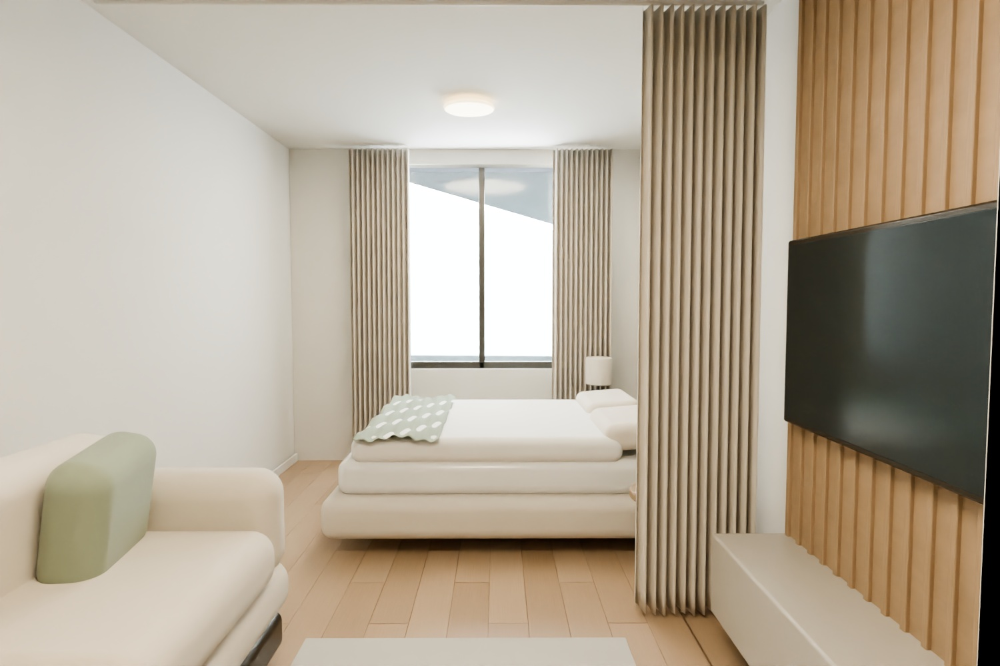

# Интерьер 360° и свободная 3D-модель

Астана, Санды-кала 2 · концепция от 14.10.2026 · один жилец.

**[Скачать Apartment_Tour.html](Apartment_Tour.html)** · **[Посмотреть обычный рендер](Preview.jpg)** · [Исходники](Tour_source.zip)

## Как открыть

1. Откройте ссылку **Apartment_Tour.html** выше.
2. В панели файла GitHub нажмите **Download raw file** (стрелка вниз). GitHub показывает код и сам не запускает HTML.
3. Откройте скачанный файл в Chrome или Edge. На компьютере достаточно двойного щелчка. Просмотрщик вложений телефона может не запускать WebGL; в таком случае используйте компьютер.

Все изображения, модель, материалы и код встроены. Интернет и установка программы для просмотра не нужны. Если браузер не поддерживает WebGL, появляется обычный рендер и пояснение.

## Два режима

| Режим | Что можно делать |
| --- | --- |
| **Обзор 360°** | Вращать взгляд мышью или пальцем; приближать колесом или двумя пальцами; переключать шесть точек кнопками комнат, стрелками внутри изображения или на плане |
| **Свободная 3D-модель** | Вращать квартиру левой кнопкой, сдвигать правой, приближать колесом; смотреть сверху, убирать верх стен или переходить к внутренним ракурсам |

В 360° наблюдатель стоит в фиксированной точке. Переходы между комнатами дискретные. Свободная модель позволяет менять положение камеры, но освещение в ней упрощено для работы браузера. Это не видеоролик и не непрерывная прогулка с проверкой столкновений.

## Что предложено

- Кухня сохранена в исходном помещении; перенос стояков в гостиную не закладывается.
- В гостиной — компактный диван, небольшой столик, деревянная ТВ-панель, шкаф и отдельная кровать с матрасом 140 × 200 см. Спальная зона отделяется шторой.
- В санузле — ванна 170 × 70 см, умывальник, унитаз и стиральная машина.
- Тёплые матовые стены под покраску, светлая древесина, спокойный текстиль, тёмные детали и кольцевые подвесы в гостиной. Материалы иллюстрируют сочетание; конкретные торговые артикулы не выбраны.
- Дверные полотна — 2600 мм. Чистая высота 2800 мм принята условно при исходной высоте 3000 мм; фактическая конструкция пола и потолка ещё требует проверки.

Геометрия основана на ранее восстановленной исходной схеме. Проёмы, наружные окна, стыки, инженерные выводы и проходы требуют контрольного обмера. Это предпроектная визуализация, а не рабочая документация для бригады. Высокие двери и шумоизоляцию потолка необходимо увязать по отметкам до закупки.

Референс использован для направления отделки. Здесь сохранены размеры и расположение окон модели квартиры; вид за окнами условный. Изображения рассчитаны в Blender Cycles по одной сцене. Их детализация и реализм не равны профессиональному рекламному рендеру из референса.

## Бюджет и прежние версии

[Предварительная смета](../materials/README.md) остаётся отдельным документом: 7 964 050 ₸ с резервом, без крупной техники. Цены товаров в ней — неподтверждённые расчётные ориентиры. Декоративная ТВ-панель и светильники этой концепции отдельно не пересчитаны; визуализация не подтверждает укладывание в 7 млн ₸.

Этот HTML отражает последнее решение: **кухня на месте, ванна, отдельная кровать**. [Старый HTML](../interactive/Apartment_3D.html) сохранён для сравнения вариантов A/C/D; он содержит прежнюю модель санузла с душем.

## Источники и проверка

[Материалы и лицензии](SOURCES.md) · [Результаты проверки](validation.json)

В архиве — редактируемая сцена Blender, модель GLB, шесть панорам, исходный код и инструкции сборки. Встроенные данные не обращаются к внешним сайтам.
