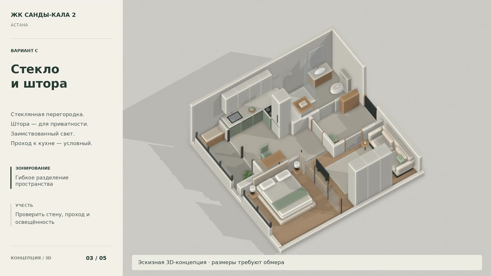

# Санды-кала 2 — 3D-видеопрезентация

**[Скачать видео MP4](Sandy_Kala_2_3D.mp4)** · [Исходные сцены и сборка — ZIP](Video_source.zip)

На странице файла GitHub нажмите **Download raw file** — кнопку со стрелкой вниз. Ролик скачивается отдельно и не входит в исходный `design/Project.zip`.

**42 секунды · 1280 × 720 · 24 кадра/с · H.264 · без звука.**

Это эскизная 3D-анимация с движением камеры по моделям квартиры. Светлый современный интерьер: дуб, тёплые светлые поверхности, шалфейные акценты и тонкие тёмные профили. Ролик показывает пространство и расстановку мебели; освещение и стекло отображены условно.

| Время | Содержание |
| --- | --- |
| 00:00–00:09 | **A — открытая спальная зона.** Отдельная кухня, без новой перегородки в жилой комнате. |
| 00:09–00:18 | **B — закрытая спальня.** Спальня у окна; гостиная без прямого наружного окна. |
| 00:18–00:27 | **C — стекло и штора.** Заимствованный свет при открытой шторе. |
| 00:27–00:35 | **Спальня изнутри.** Матрас 160 × 200 см; проходы уточняются после обмера и выбора мебели. |
| 00:35–00:42 | **Дверь в полный рост.** Полотно высотой 2600 мм. |

## Что требует уточнения

Геометрия построена по предоставленному плану с допущениями и не заменяет натурный обмер или рабочие чертежи. Варианты B/C предполагают условный проход между кухней и гостиной: конструкцию стены и допустимость перепланировки необходимо проверить. Достаточность естественного освещения не рассчитана. Лоджия остаётся отдельной от отапливаемого помещения.

Исходная высота по данным собственника — 3,00 м. Чистая высота модели **2,86 м принята условно** с учётом предполагаемых слоёв пола и потолка. Монтажный проём под полотно 2600 мм определяется выбранной дверной системой, перемычкой и отметкой чистого пола. В общих видах стены и двери частично срезаны для обозримости; полную высоту полотна показывает последний фрагмент.

## Исходники

`Video_source.zip` содержит пять сцен Blender с анимированными камерами, оформление и скрипты повторного рендера и сборки. Исходные кадры отрендерены в Blender Workbench при 8 кадрах/с; промежуточные кадры получены линейной интерполяцией до 24 кадров/с. Общий вид, интерьер и деталь двери сняты отдельными камерами; переходы между фрагментами монтажные.

Версия видео: 11.10.2026.
